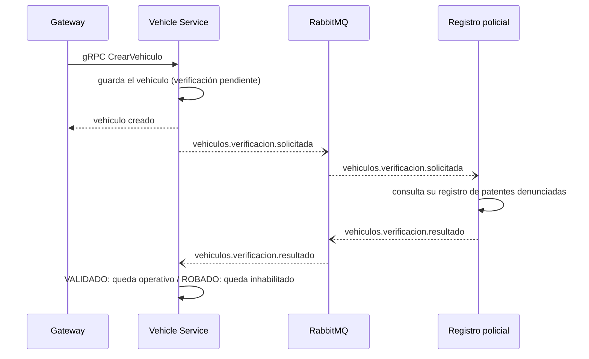
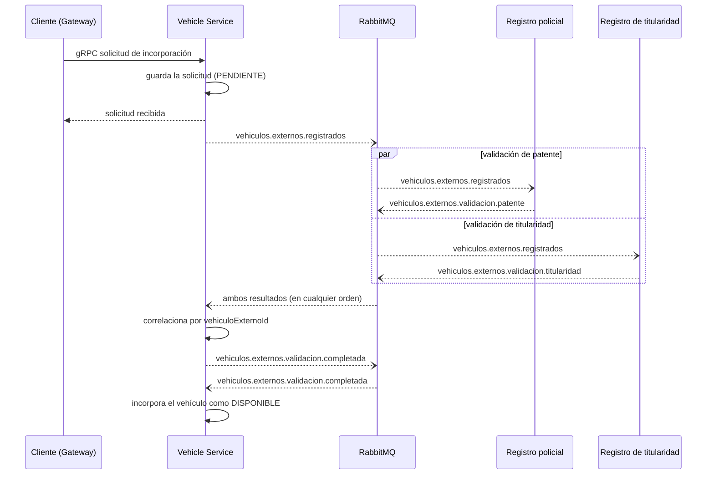
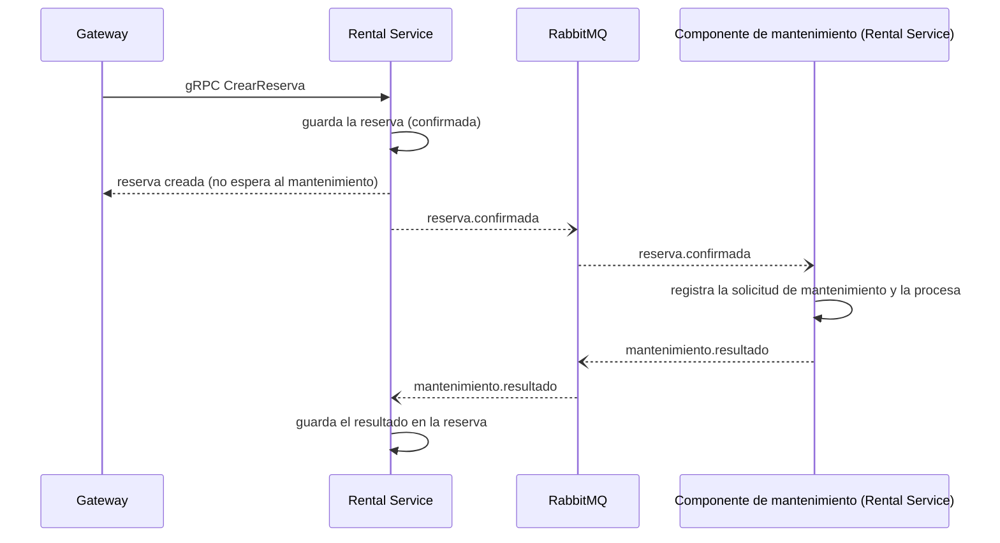

# Eventos de Rentar — Hito 3 (RabbitMQ)

Catálogo de eventos, convenciones y guía del entorno. Es el contrato que comparten todos los servicios: si algo de acá no coincide con el código, **se corrige acá primero**.

## 1. Broker

- **RabbitMQ 3.13** (imagen `rabbitmq:3.13-management`), servicio `rabbitmq` de `docker-compose.yml`.
- AMQP en `localhost:5672`; panel web en http://localhost:15672 (usuario `guest`, contraseña `guest`, solo desarrollo).
- Dentro de la red de Compose los servicios lo ven como `rabbitmq:5672`.
- **La topología (exchange, colas y bindings) se crea sola al iniciar el broker** a partir de [`rabbitmq/definitions.json`](../rabbitmq/definitions.json). Los servicios **no declaran** exchanges ni colas: solo publican y consumen.
- El mismo archivo declara también el *virtual host* `/` y el usuario `guest` con sus permisos: en esta versión RabbitMQ importa las definiciones antes de crear el virtual host por defecto, y sin esa declaración el broker no arranca (`Please create virtual host "/" prior to importing definitions`).

### Topología

- Un único exchange de tipo **topic**, durable: `rentar.eventos`.
- La **routing key es el nombre del evento**, tal cual figura en el enunciado (`vehiculos.verificacion.solicitada`, `reserva.confirmada`, …).
- Cada consumidor tiene **su propia cola**, llamada `<consumidor>.<routing key>`. Si dos componentes consumen el mismo evento (por ejemplo `vehiculos.externos.registrados`), cada uno tiene su cola y lo procesa de forma independiente.
- Todas las colas son durables y tienen *dead-letter exchange* `rentar.eventos.dlx` → cola `rentar.dlq`.

| Cola | Routing key (binding) | Consume | Publica el evento |
|------|-----------------------|---------|-------------------|
| `registro-policial.vehiculos.verificacion.solicitada` | `vehiculos.verificacion.solicitada` | Registro policial | Vehicle Service |
| `vehicle-service.vehiculos.verificacion.resultado` | `vehiculos.verificacion.resultado` | Vehicle Service | Registro policial |
| `registro-policial.vehiculos.externos.registrados` | `vehiculos.externos.registrados` | Registro policial | Vehicle Service |
| `titularidad.vehiculos.externos.registrados` | `vehiculos.externos.registrados` | Registro de titularidad | Vehicle Service |
| `vehicle-service.vehiculos.externos.validacion.patente` | `vehiculos.externos.validacion.patente` | Vehicle Service | Registro policial |
| `vehicle-service.vehiculos.externos.validacion.titularidad` | `vehiculos.externos.validacion.titularidad` | Vehicle Service | Registro de titularidad |
| `vehicle-service.vehiculos.externos.validacion.completada` | `vehiculos.externos.validacion.completada` | Vehicle Service | Vehicle Service |
| `mantenimiento.reserva.confirmada` | `reserva.confirmada` | Componente de mantenimiento de Rental Service | Rental Service |
| `rental-service.mantenimiento.resultado` | `mantenimiento.resultado` | Rental Service | Componente de mantenimiento de Rental Service |
| `rentar.dlq` | (fanout desde `rentar.eventos.dlx`) | nadie, se revisa a mano | — |

> Componentes nuevos de este hito: **Registro policial**, **Registro de titularidad** y **Mantenimiento**. Para el flujo de reservas, el componente de mantenimiento está implementado dentro de `rental-service` y consume/publica mediante las colas existentes; no requiere un microservicio adicional.
>
> Si algún equipo necesita otra cola o binding, **se agrega en `definitions.json`** (PR chico) y se actualiza esta tabla. No se declaran colas desde el código: si el código redeclara una cola con otros argumentos, RabbitMQ la rechaza (`PRECONDITION_FAILED`).

## 2. Convenciones

### Formato del mensaje

- Cuerpo en **JSON UTF-8**, `content_type = application/json`, con **exactamente los campos del enunciado** (los payloads de la sección 3). No se agregan campos de envoltura al cuerpo.
- Los identificadores son **números** (`long`), no strings. Las fechas, `yyyy-MM-ddTHH:mm:ss` sin zona, igual que en el resto de Rentar.
- Cada evento se identifica por las **propiedades AMQP** del mensaje, que el productor tiene que completar siempre:

| Propiedad AMQP | Valor |
|----------------|-------|
| `message_id` | UUID generado por el productor (identifica el evento; sirve para detectar duplicados) |
| `type` | Nombre del evento = routing key (`vehiculos.verificacion.solicitada`) |
| `timestamp` | Momento en que se publicó |
| `correlation_id` | Identificador del proceso (ver abajo), como texto |
| `content_type` | `application/json` |

### Correlación

El `correlation_id` es el id de negocio que une todos los eventos de un mismo proceso. **El consumidor lo copia tal cual en el evento de respuesta**.

| Flujo | `correlation_id` |
|-------|------------------|
| Verificación de vehículos | `vehiculoId` |
| Incorporación de vehículos externos | `vehiculoExternoId` |
| Mantenimiento preventivo | `reservaId` |

### Reintentos y errores

- Los eventos se entregan **al menos una vez**: un consumidor puede recibir el mismo mensaje dos veces. **Todo consumidor tiene que ser idempotente** (si el resultado ya estaba aplicado, no hace nada y confirma el mensaje).
- Reintentos en el consumidor: **3 intentos** con espera creciente (1 s, 2 s, 4 s). Si siguen fallando, se rechaza sin reencolar y el mensaje va a `rentar.dlq` (se revisa en el panel web).
- Un mensaje mal formado o con un valor desconocido no se reintenta: se rechaza directo.
- **Publicar después del commit.** Si el evento sale de una operación que escribe en la base, se publica **cuando la transacción ya se confirmó**, no antes. Así nunca se anuncia algo que después se deshizo.
- **El flujo principal no espera.** Un productor no queda esperando ninguna respuesta del evento. Si el broker no responde al publicar, se registra el error en el log y la operación principal (crear el vehículo, confirmar la reserva) **no falla**.

### Nombres

- Eventos: `dominio.[subdominio].hecho` en minúsculas, separado por puntos, como en el enunciado.
- Colas: `<consumidor>.<routing key>`.
- Variables de entorno de conexión: `RABBITMQ_HOST`, `RABBITMQ_PORT`, `RABBITMQ_USER`, `RABBITMQ_PASSWORD` (en Compose ya están definidas para `vehicle-service` y `rental-service`; los componentes nuevos las agregan igual).

## 3. Catálogo de eventos

### Flujo 1 — Verificación de vehículos

**Valores de resultado:** `VALIDADO` o `ROBADO`. `ROBADO` **no es un estado operativo del vehículo**: los estados siguen siendo `DISPONIBLE` y `EN_ALQUILER`. Un vehículo `ROBADO` queda inhabilitado para nuevas operaciones (por ejemplo, no aparece como disponible y no se puede reservar).

#### `vehiculos.verificacion.solicitada`
- Publica: **Vehicle Service**, después de registrar el vehículo.
- Consume: **Registro policial**.

```json
{ "vehiculoId": 15, "patente": "ABC123" }
```

#### `vehiculos.verificacion.resultado`
- Publica: **Registro policial**, después de consultar su registro.
- Consume: **Vehicle Service**, que actualiza el vehículo.

```json
{ "vehiculoId": 15, "patente": "ABC123", "resultado": "VALIDADO" }
```



### Flujo 2 — Incorporación de vehículos de propietarios externos

**Valores de resultado de cada validación:** `VALIDADO` o `RECHAZADO`.
**Estados de la solicitud:** `PENDIENTE` al comenzar → `RECHAZADA` si alguna validación falla. Si ambas son `VALIDADO`, el vehículo se incorpora como `DISPONIBLE`.

#### `vehiculos.externos.registrados`
- Publica: **Vehicle Service**, después de guardar la solicitud en `PENDIENTE`.
- Consumen (cada uno en su cola): **Registro policial** y **Registro de titularidad**.

```json
{ "vehiculoExternoId": 50, "clienteId": 89, "patente": "DEF456" }
```

#### `vehiculos.externos.validacion.patente`
- Publica: **Registro policial** (la patente no está denunciada → `VALIDADO`; denunciada → `RECHAZADO`).
- Consume: **Vehicle Service**.

```json
{ "vehiculoExternoId": 50, "patente": "DEF456", "resultado": "VALIDADO" }
```

#### `vehiculos.externos.validacion.titularidad`
- Publica: **Registro de titularidad** (el `clienteId` es el titular de la patente en su registro → `VALIDADO`; si no → `RECHAZADO`).
- Consume: **Vehicle Service**.
- El registro de titularidad necesita el `documento` del cliente, que **no viaja en `registrados`**: lo obtiene del Customer Service por gRPC (consulta al cliente por su `clienteId`) y lo informa en el evento.

```json
{
  "vehiculoExternoId": 50,
  "clienteId": 89,
  "documento": "30123456",
  "patente": "DEF456",
  "resultado": "VALIDADO"
}
```

#### `vehiculos.externos.validacion.completada`
- Publica: **Vehicle Service**, cuando ambas validaciones llegaron y son `VALIDADO`.
- Consume: **Vehicle Service**, que crea el vehículo como `DISPONIBLE`.

```json
{ "vehiculoExternoId": 50 }
```

#### Reglas de correlación (Vehicle Service)

- Las dos validaciones pueden llegar **en cualquier orden**: se guarda el resultado de cada una en la solicitud y se evalúa después de cada mensaje.
- Si **alguna es `RECHAZADO`**: la solicitud pasa a `RECHAZADA`, el vehículo **no** se incorpora y **no** se publica `completada`. Si la otra validación llega después, se guarda pero no cambia nada.
- Si **ambas son `VALIDADO`**: se publica `completada` **una sola vez** (si llega un mensaje duplicado, no se vuelve a publicar).
- Al consumir `completada` se incorpora el vehículo como `DISPONIBLE`, asociado al `clienteId` dueño, y la solicitud queda `INCORPORADA`.



### Flujo 3 — Mantenimiento preventivo asociado a una reserva

**Valores de resultado:** `REALIZADO` o `NO_REALIZADO`.
**La confirmación de la reserva no se bloquea** esperando el resultado del mantenimiento.

#### `reserva.confirmada`
- Publica: **Rental Service**, después de confirmar la reserva (con la transacción ya confirmada).
- Consume: el componente de mantenimiento de **Rental Service**, que registra la solicitud de mantenimiento preventivo del vehículo y la procesa.

```json
{
  "reservaId": 150,
  "vehiculoId": 15,
  "fechaInicio": "2026-10-10T10:00:00",
  "fechaFin": "2026-10-15T10:00:00"
}
```

#### `mantenimiento.resultado`
- Publica: el componente de mantenimiento de **Rental Service**, al terminar de procesar.
- Consume: **Rental Service**, que guarda el resultado asociado a la reserva.

```json
{ "reservaId": 150, "vehiculoId": 15, "resultado": "REALIZADO" }
```



## 4. Guía para el entorno

### Levantar

```bash
docker compose up --build            # todo el sistema, incluido RabbitMQ
docker compose up -d postgres rabbitmq   # solo la infraestructura (para desarrollar un servicio desde el IDE)
docker compose ps                    # rabbitmq tiene que figurar como (healthy)
docker compose down -v               # apagar y borrar las bases
```

Con el broker arriba, el panel web http://localhost:15672 (`guest` / `guest`) muestra:
- **Exchanges** → `rentar.eventos` y `rentar.eventos.dlx`.
- **Queues** → las colas de la sección 1 con sus mensajes.
- **Queues → `rentar.dlq`** → mensajes que fallaron todos los reintentos.

> Si el puerto **5672** o **15672** está ocupado en la máquina, liberarlo (o publicarlo en otro puerto en `docker-compose.yml`) y volver a levantar. Si se cambia `definitions.json`, hay que recrear el contenedor: `docker compose up -d --force-recreate rabbitmq` (o `down -v` y `up`).

### Probar un componente sin que estén los demás

Se puede publicar un evento a mano y mirar la respuesta, sin esperar al productor real. Desde la terminal, con la API de administración (la respuesta tiene que decir `"routed":true`; si dice `false`, la routing key no tiene cola):

```bash
curl -s -u guest:guest -H "content-type: application/json" \
  -X POST http://localhost:15672/api/exchanges/%2F/rentar.eventos/publish \
  -d '{
        "properties": {
          "message_id": "11111111-1111-1111-1111-111111111111",
          "type": "vehiculos.verificacion.solicitada",
          "correlation_id": "15",
          "content_type": "application/json"
        },
        "routing_key": "vehiculos.verificacion.solicitada",
        "payload": "{\"vehiculoId\":15,\"patente\":\"ABC123\"}",
        "payload_encoding": "string"
      }'
```

Para leer lo que quedó en una cola sin consumirlo: panel web → **Queues** → la cola → **Get messages** (modo *Nack message requeue true*).

### Conectar un servicio Spring Boot

Dependencia (Vehicle, Rental y los componentes nuevos):

```xml
<dependency>
    <groupId>org.springframework.boot</groupId>
    <artifactId>spring-boot-starter-amqp</artifactId>
</dependency>
```

`application.properties`:

```properties
spring.rabbitmq.host=${RABBITMQ_HOST:localhost}
spring.rabbitmq.port=${RABBITMQ_PORT:5672}
spring.rabbitmq.username=${RABBITMQ_USER:guest}
spring.rabbitmq.password=${RABBITMQ_PASSWORD:guest}

# Reintentos del consumidor: 3 intentos (1 s, 2 s, 4 s) y después va a rentar.dlq
spring.rabbitmq.listener.simple.retry.enabled=true
spring.rabbitmq.listener.simple.retry.max-attempts=3
spring.rabbitmq.listener.simple.retry.initial-interval=1s
spring.rabbitmq.listener.simple.retry.multiplier=2
spring.rabbitmq.listener.simple.default-requeue-rejected=false
```

Conversor JSON. Cada servicio tiene sus propias clases para los eventos, así que **el consumidor tiene que inferir el tipo desde el parámetro del `@RabbitListener`**, no desde el encabezado `__TypeId__` que agrega Spring (que trae el nombre de la clase del productor):

```java
@Bean
MessageConverter jsonMessageConverter() {
    Jackson2JsonMessageConverter conv = new Jackson2JsonMessageConverter();
    DefaultJackson2JavaTypeMapper mapper = new DefaultJackson2JavaTypeMapper();
    mapper.setTypePrecedence(Jackson2JavaTypeMapper.TypePrecedence.INFERRED);
    conv.setJavaTypeMapper(mapper);
    return conv;
}
```

Publicar (completando siempre las propiedades de la sección 2):

```java
rabbitTemplate.convertAndSend("rentar.eventos", "vehiculos.verificacion.solicitada", evento, m -> {
    MessageProperties p = m.getMessageProperties();
    p.setMessageId(UUID.randomUUID().toString());
    p.setType("vehiculos.verificacion.solicitada");
    p.setCorrelationId(String.valueOf(evento.vehiculoId()));
    p.setTimestamp(new Date());
    return m;
});
```

Consumir (la cola ya existe, no se declara):

```java
@RabbitListener(queues = "registro-policial.vehiculos.verificacion.solicitada")
void onSolicitada(VerificacionSolicitada evento) { ... }
```

Para publicar después del commit: `@TransactionalEventListener(phase = AFTER_COMMIT)` sobre un evento de Spring, o `TransactionSynchronizationManager.registerSynchronization(...)` con `afterCommit()`.

### Agregar un componente nuevo al Compose

Plantilla para Registro policial, Registro de titularidad y Mantenimiento (se agrega cuando el servicio tenga su `Dockerfile`):

```yaml
  mantenimiento:
    build:
      context: .
      dockerfile: mantenimiento/Dockerfile
    environment:
      RABBITMQ_HOST: rabbitmq
      RABBITMQ_PORT: 5672
      RABBITMQ_USER: guest
      RABBITMQ_PASSWORD: guest
      # DB_URL / DB_USER / DB_PASSWORD si tiene base propia
    depends_on:
      rabbitmq:
        condition: service_healthy
```

Las reglas del Hito 2 siguen valiendo: nada de configuración fija a `localhost`, cada servicio con su Dockerfile y su entrada en el Compose desde el primer PR, y no se mergea nada que no levante con `docker compose up --build`.
